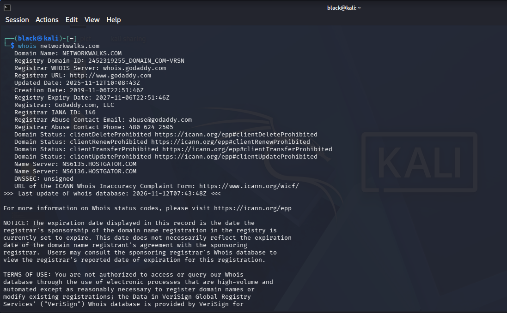
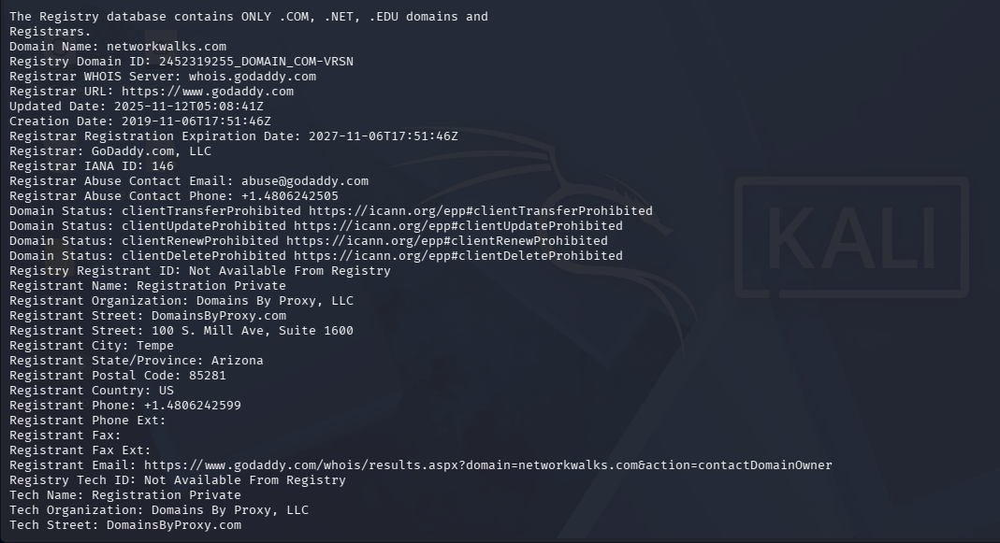
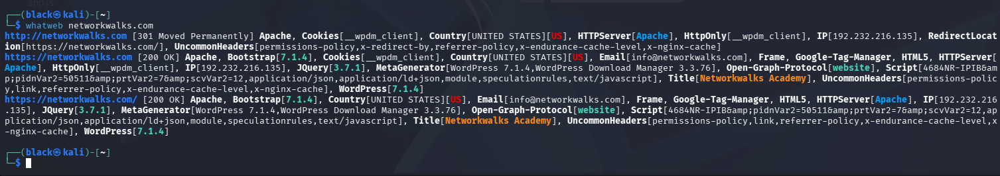
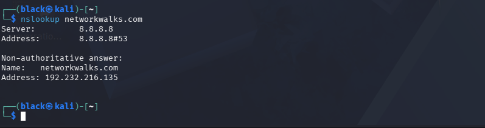
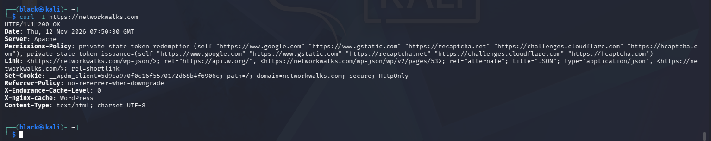
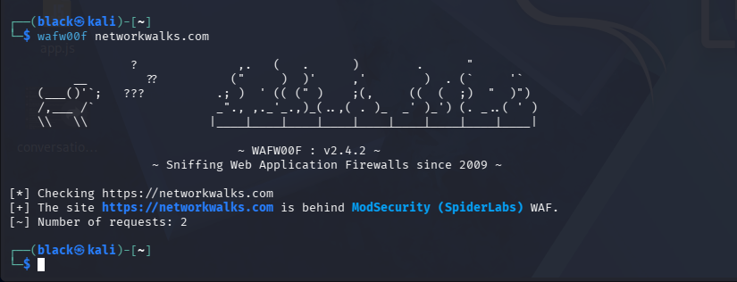
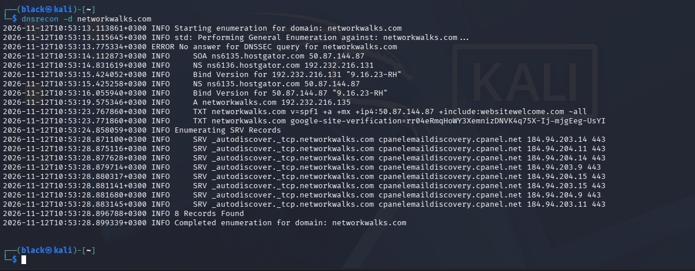

# 🔍 W2-PM1 — Kali Linux Footprinting

### Networkwalks Cybersecurity Internship — Batch B084 | Week 2

> **Phase 1:** Reconnaissance & Footprinting

---

# 📌 Project Overview

As part of Week 2 of my Networkwalks Cybersecurity Internship, I worked on **W2-PM1 — Kali Linux Footprinting**.

In this module, I practiced the initial reconnaissance phase of a penetration test by using different Kali Linux tools to collect information about the authorized target **networkwalks.com**.

The main focus was to understand what information can be identified before moving toward vulnerability assessment or exploitation.

During the exercise, I looked at:

- 🔎 Domain registration information
- 🌐 Web technologies
- 📡 Target IP address
- 📋 HTTP response headers
- 🛡️ Web Application Firewall (WAF)
- 🗂️ DNS records and infrastructure

All activities were performed within the authorized educational scope.

---

# 🎯 Project Objectives

The main objectives of this module were to:

- Understand the reconnaissance and footprinting phase.
- Learn how to collect publicly available information about a target.
- Identify the technologies used by a website.
- Find the IP address associated with a domain.
- Analyze HTTP response headers.
- Identify whether a WAF is being used.
- Enumerate DNS records.
- Understand how this information can help during further security testing.
- Document the results with proper screenshots and observations.

---

# 🧰 Tools & Technologies

| Category | Tool | Purpose |
|---|---|---|
| 🐉 Security OS | Kali Linux | Used as the reconnaissance environment |
| 🔎 Domain Reconnaissance | `WHOIS` | Collect domain registration information |
| 🌐 Web Fingerprinting | `WhatWeb` | Identify web technologies |
| 📡 DNS Resolution | `nslookup` | Resolve domain and IP information |
| 📋 HTTP Analysis | `curl -I` | Check HTTP response headers |
| 🛡️ WAF Detection | `Wafw00f` | Detect Web Application Firewall |
| 🗂️ DNS Enumeration | `DNSRecon` | Enumerate DNS records |

---

# 🎯 Target Information

| Field | Details |
|---|---|
| Target Domain | `networkwalks.com` |
| Assessment Type | Footprinting & Reconnaissance |
| Phase | Phase 1 — Reconnaissance & Footprinting |
| Environment | Kali Linux |
| Scope | Authorized educational assessment |
| Module | W2-PM1 — Multiple Kali Tools |

---

# 🧭 Methodology

I followed a simple reconnaissance workflow during this module:

```text
                    TARGET
                       │
                       ▼
              ┌─────────────────┐
              │      WHOIS      │
              │ Domain Details  │
              └────────┬────────┘
                       │
                       ▼
              ┌─────────────────┐
              │     WhatWeb     │
              │ Web Technologies│
              └────────┬────────┘
                       │
                       ▼
              ┌─────────────────┐
              │    nslookup     │
              │     DNS / IP    │
              └────────┬────────┘
                       │
                       ▼
              ┌─────────────────┐
              │     curl -I     │
              │  HTTP Headers   │
              └────────┬────────┘
                       │
                       ▼
              ┌─────────────────┐
              │    Wafw00f      │
              │  WAF Detection  │
              └────────┬────────┘
                       │
                       ▼
              ┌─────────────────┐
              │    DNSRecon     │
              │   DNS Records   │
              └────────┬────────┘
                       │
                       ▼
              ┌─────────────────┐
              │    Findings     │
              │  & Risk Review  │
              └─────────────────┘
```

---

# 🔎 Activities Performed

## 1️⃣ WHOIS Enumeration

### 🎯 What I Did

I started the reconnaissance by using **WHOIS** to collect publicly available registration information about the target domain.

### 🛠️ Tool Used

```text
WHOIS
```

### 💻 Command

```bash
whois networkwalks.com
```

### 🔍 Result

**Key findings:**

* **Registrar:** `GoDaddy.com, LLC`
* **Registration Date:** `2019-11-06T22:51:46Z`
* **Expiry Date:** `2027-11-06T22:51:46Z`
* **Name Servers:** `NS6135.HOSTGATOR.COM`

The WHOIS lookup provided publicly available information related to the registration of the domain.

### 💡 What I Learned

WHOIS information can help in understanding who manages or is associated with a domain.

From a security perspective, this information can be useful during the initial reconnaissance phase when building a profile of the target.

### 📸 Evidence 

**SS 01 — WHOIS Domain Information**





---

## 2️⃣ Web Technology Fingerprinting — WhatWeb

### 🎯 What I Did

Next, I used **WhatWeb** to identify the technologies being used by the target website.

### 🛠️ Tool Used

```text
WhatWeb
```

### 💻 Command

```bash
whatweb networkwalks.com
```

### 🔍 Result

The scan identified the following information:

| Technology | Result |
|---|---|
| CMS | WordPress 7.1.4 |
| Plugin | WP Download Manager 3.3.76 |
| Web Server | Apache |
| IP Address | `192.232.216.135` |

### 💡 What I Learned

WhatWeb is useful for quickly understanding the technology stack behind a website.

Knowing the CMS, plugins, and server technologies can help a security tester decide what should be investigated further during an authorized assessment.

> **Note:** Finding a technology or version does not by itself mean that the target is vulnerable.

### 📸 Evidence

**SS 02 — WhatWeb Web Technology Fingerprinting**



---

## 3️⃣ DNS Resolution — nslookup

### 🎯 What I Did

I then used **nslookup** to resolve the target domain and check the IP address associated with it.

### 🛠️ Tool Used

```text
nslookup
```

### 💻 Command

```bash
nslookup networkwalks.com
```

### 📋 Result

**Domain:** `networkwalks.com`

**IP Address:** `192.232.216.135`

### 💡 What I Learned

DNS resolution is one of the basic steps in reconnaissance.

Finding the IP address gives a tester more information about the infrastructure associated with the domain and can be useful for further authorized testing.

### 📸 Evidence 

**SS 03 — DNS Resolution**



---

## 4️⃣ HTTP Header Analysis — curl

### 🎯 What I Did

After resolving the target, I used **curl** to check the HTTP response headers returned by the website.

### 🛠️ Tool Used

```text
curl
```

### 💻 Command

```bash
curl -I https://networkwalks.com
```

### 🔍 Result

The command returned the HTTP response headers from the target.

I reviewed the response for technical information that was being exposed by the web server.

### 💡 What I Learned

HTTP headers can sometimes provide useful information about the web server and application environment.

During a penetration test, this information can help in understanding the technologies and configuration of the target.

### 📸 Evidence 

**SS 04 — HTTP Response Headers**



---

## 5️⃣ WAF Detection — Wafw00f

### 🎯 What I Did

I used **Wafw00f** to check whether a Web Application Firewall was being used by the target.

### 🛠️ Tool Used

```text
Wafw00f
```

### 💻 Command

```bash
wafw00f https://networkwalks.com
```

### 🔍 Result

The tool identified:

**WAF Detected:** Yes

**WAF Identified:** `ModSecurity (SpiderLabs)`


### 💡 What I Learned

Wafw00f can help identify the WAF technology protecting a web application.

Knowing that a WAF is present gives a tester an idea about the defensive controls around the application.

> **Note:** Identifying a WAF is only a reconnaissance observation and is not a confirmed vulnerability.

### 📸 Screenshot

**SS 05 — WAF Detection**



---

## 6️⃣ DNS Enumeration — DNSRecon

### 🎯 What I Did

Finally, I used **DNSRecon** to collect and enumerate publicly available DNS information for the target domain.

### 🛠️ Tool Used

```text
DNSRecon
```

### 💻 Command

```bash
dnsrecon -d networkwalks.com
```

### 🔍 Result

The enumeration identified DNS information including:

- MX records
- TXT records
- cPanel-related SRV records
- Mail infrastructure

One of the identified mail-related records was:

```text
mail.networkwalks.com
```

### 💡 What I Learned

DNS enumeration can reveal useful information about the infrastructure associated with a domain.

MX, TXT, and SRV records can provide information about mail services and other services connected to the organization's domain.

### 📸 Screenshot

**SS 06 — DNSRecon Enumeration**


---

# 📊 Findings Summary

After completing the six reconnaissance activities, I identified the following observations:

| No. | Finding | Risk |
|---:|---|---|
| 1 | Web technology and version information exposed | 🟠 Medium |
| 2 | WAF technology identifiable | 🟢 Low |
| 3 | DNS infrastructure information exposed | 🟠 Medium |

> ⚠️ These are reconnaissance observations, not confirmed vulnerabilities. Further authorized testing would be required to validate them.

---

# ⚠️ Risk & Security Impact

### 1. Web Technology Information Exposure — Medium

**Observation:** The target uses WordPress 7.0.4, WP Download Manager 3.3.58, and Apache.

**Potential Impact:** Exposed technology information could help attackers identify software versions requiring further security investigation.

**Recommendation:** Keep WordPress, plugins, and server software updated.

### 2. WAF Technology Disclosure — Low

**Observation:** Wafw00f identified ModSecurity (SpiderLabs).

**Potential Impact:** This reveals information about the security technology protecting the web application.

**Recommendation:** Keep the WAF enabled, updated, properly configured, and monitored.

### 3. DNS Infrastructure Exposure — Medium

**Observation:** DNSRecon identified MX, TXT, and cPanel-related SRV records.

**Potential Impact:** These records provide information about the organization's external infrastructure.

**Recommendation:** Regularly review DNS records and remove unnecessary or outdated entries.

---

# 📈 Overall Risk Assessment

| Risk Area | Risk Level |
|---|---|
| Web Technology Exposure | 🟠 Medium |
| WAF Technology Disclosure | 🟢 Low |
| DNS Infrastructure Exposure | 🟠 Medium |
| **Overall Reconnaissance Risk** | **🟠 Medium** |

The findings mainly relate to information exposure during reconnaissance. No confirmed exploitation is claimed.

---

# 🛡️ Recommendations

- **Web Application:** Update WordPress and plugins, and review HTTP security headers.
- **WAF:** Keep ModSecurity enabled, updated, and monitored.
- **DNS:** Review DNS records and remove unnecessary or outdated entries.
- **External Attack Surface:** Perform regular authorized reconnaissance and monitor publicly exposed assets.

---

# 🧠 Key Learning Outcomes

During this module, I gained practical experience with:

- WHOIS enumeration
- Web technology fingerprinting
- DNS resolution
- HTTP header analysis
- WAF detection
- DNS enumeration
- Basic risk assessment
- Technical documentation

I learned that reconnaissance helps build an initial understanding of a target before vulnerability assessment or exploitation.

---


# ⚖️ Legal & Ethical Disclaimer

All activities were performed within an authorized educational scope as part of cybersecurity training.

The tools and techniques demonstrated are intended for cybersecurity education, research, and authorized penetration testing.

> ⚠️ Never perform reconnaissance, scanning, or exploitation against systems without explicit authorization.

---

# 📚 Acknowledgement

This module was completed as part of the **Networkwalks Cybersecurity Internship Program — Batch B082**.

The exercise provided practical experience with reconnaissance tools and demonstrated the importance of information gathering in penetration testing.

**🔐 Learn responsibly. Test ethically. Document professionally.**
